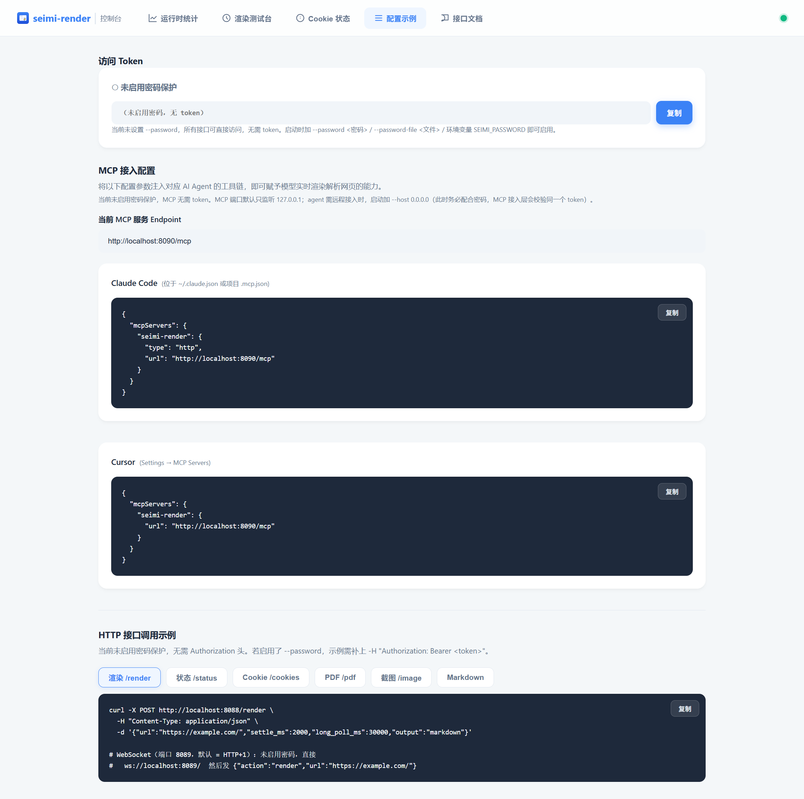
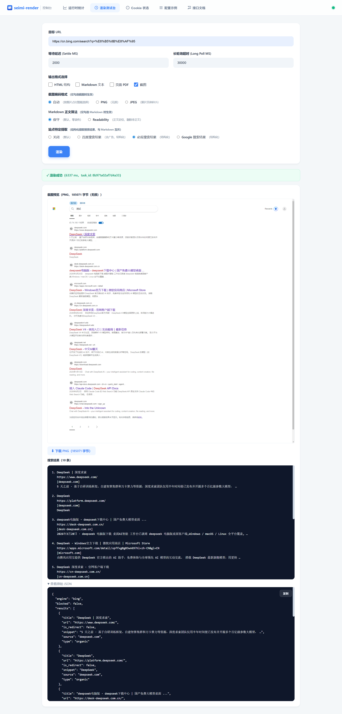

# Claude Code 联网搜索用不了？给它一个专属浏览器，搜索自由立刻回来

<!-- 备选标题（发布时可任选）：
1. 你的 Claude Code 还在说"我无法联网"？三行配置，还它搜索自由
2. Claude Code 不能联网搜？这个开源项目让它在你本机就能 Google it
3. 别再等 WebSearch 可用了：给 Claude Code 接一个真浏览器 -->

用 Claude Code 的朋友，大概率碰到过这个场景：

你让它"查一下这个库最新版本的 API 怎么写"，或者"搜搜这个报错有没有人踩过坑"，它一脸无辜地回你：**抱歉，我无法访问互联网。**

又或者更隐蔽一点——工具列表里那个 `WebSearch` 压根不出现，`WebFetch` 勉强能跑，但拉回来的东西不是被风控拦下，就是一堆没有正文的空壳 HTML。

你看着手里这个能写出百万行工程的 AI，突然发现它**是个瞎子**。

---

## 先说清楚：为什么 Claude Code 的联网搜索总是"差一口气"

把常见原因拆开看，其实是三层：

**第一层：`WebSearch` 本身不可用。**

这个工具的执行方在 Anthropic 服务端，能不能用取决于你的 API 通道、账号类型和区域——官方直连的幸运儿可能一切正常，但走中转 API、自建网关的朋友，要么一调用就报错，要么工具列表里干脆没有它。这不是你的配置问题，是通道不支持。

**第二层：`WebFetch` 拿到的是空壳。**

`WebFetch` 干的活本质上是一次"curl 式"的裸请求：不执行 JS。现在互联网上稍有含金量的页面，正文几乎全靠 JS 异步渲染，你 fetch 回来的就是一排空 `<div>`。更要命的是，一个没有浏览器指纹的裸请求，在搜索引擎和大多数站点眼里就是"非人类"——直接验证页伺候。

**第三层：官方搜索 API 又贵又麻烦。**

Google、Bing 的官方搜索 API，申请、key、按次计费、额度感人。给个人开发者日常查资料用？杀鸡用了牛刀，还得先租牛。

三层叠加，结论其实很清晰：

> **Claude Code 缺的不是搜索接口，而是一双真正能打开网页的眼睛。**

与其苦等通道支持，不如换思路——直接给它一个浏览器。

---

## 解题思路：不修接口，给它一个真浏览器

Claude Code 原生支持 MCP（Model Context Protocol）扩展。这意味着我们可以接一个"真浏览器"MCP 服务进来，把联网能力**构建在你自己的本机**——不再受任何服务端工具可用性的摆布。

这就是 **SeimiRender** 登场的方式。

[SeimiRender](https://github.com/zhegexiaohuozi/seimi-render) 是一个基于 Chromium 的本地网页渲染服务，原生内置 MCP server。你提交一个 URL，它就用**真实浏览器行为**去渲染页面——执行 JS、等待异步内容、跑完 SPA 路由——然后把完整结果交还给 AI：HTML、Markdown 正文、PDF、截图，甚至是**结构化的搜索引擎结果 JSON**。

它和"curl 类 fetch"的本质区别在于：**搜索引擎对"人"友好，对脚本狠。而 SeimiRender 出手就是一个如假包换的 Chromium。**

配好之后，你对 Claude Code 说一句"帮我查一下北京种植牙哪些医院靠谱"，它会自己规划：调搜索引擎拿结构化结果 → 挑几条点进去读全文 → 综合给你一个带出处的回答。全程静默，不打扰你正在干的任何事。

---

## 三步接入，五分钟找回搜索自由

**第一步：启动服务。**

不想编译的直接去 GitHub Releases 下载对应平台的现成包，开箱即用：

👉 https://github.com/zhegexiaohuozi/seimi-render/releases

```bash
# macOS 示例
build/seimi-render.app/Contents/MacOS/seimi-render --http-port 8088 --ws-port 8089
```

**第二步：三行配置，接进 Claude Code。**

在 `~/.claude.json`（全局）或项目的 `.mcp.json` 里加上：

```json
{
  "mcpServers": {
    "seimi-render": {
      "type": "http",
      "url": "http://localhost:8090/mcp"
    }
  }
}
```

> 启用了 `--password` 的话，加一个 `headers` 字段带 `Authorization: Bearer <token>` 即可。这段 JSON 不用手敲——SeimiRender 自带图形化管理后台，「配置示例」标签页一键复制。



**第三步：验证。**

在 Claude Code 里输入 `/mcp`，看到 `seimi-render` 已连接，就成了。直接说一句：

> 用 browser_search 搜一下 Qt 6.9 的新特性

看着它自己拿起浏览器开始干活吧。

---

## 接入之后：一个不花钱、不限量的搜索引擎 API

SeimiRender 暴露给 Claude Code 的第一个杀手锏，是 `browser_search` 工具。

各大搜索引擎的官方 API 要么收费、要么额度感人、要么申请繁琐——但搜索引擎本身是免费开放的，问题只是它返回的是给人看的 HTML，不是给程序用的 JSON。SeimiRender 把这件事彻底 API 化了：

- **多引擎**：Google / 必应 / 百度 / DuckDuckGo，一个参数切换
- **结构化输出**：每条结果包含标题、URL、摘要、来源，附"相关搜索"，**广告自动过滤**
- **不限量、不花钱**：搜索就发生在你本机的 Chromium 里，没有 key，没有配额



更关键的是，它把"搜索被反爬拦截"这件事做成了**工程化的一整套对抗**——这正是自己手搓一个 headless Chrome 搜索脚本很快就会撞上的墙：

- **stealth 指纹统一**（默认开启）：所有渲染实例伪装成同一个 Chrome 桌面环境，UA / 屏幕 / WebGL / canvas 指纹一致，融入人群而不是鹤立鸡群
- **会话预热**：进程启动先隐藏加载一次搜索引擎首页拿到会话 cookie，再接业务请求——冷启动零 cookie 直打搜索是风控的最高危窗口
- **命中验证页自动退避重试**：比如撞上 Google 的 `/sorry/` 验证页，自动换全新页面退避重试（带随机抖动，防多实例节律指纹）
- **失败类型化**：重试耗尽会明确返回 `BLOCKED` 标记——Claude Code 看到 marker 会**自动换引擎**再搜（Google 被拦就切必应、百度），而不是对着失败干瞪眼
- **运行时代理热切换**：`--proxy` 或 `POST /proxy` 随时改上游代理，无需重启，接代理池彻底避开 IP 流控

还有一点容易被忽略的控制权：即便哪天 `WebSearch` 可用了，它的搜索发生在 Anthropic 服务端；而 SeimiRender 的搜索发生在**你本机**——出口 IP 你说了算（随时挂代理），可以带上你自己的登录态 cookie，检索行为不用出你的机器。

---

## 实际用起来是什么体验

理论说完了，看一段真实的工作流。

你对 Claude Code 说："帮我调研一下 Rust axum 框架的中间件怎么写，要最新版本的写法。"

它自己会拆成几步：

1. 调 `browser_search` 拿搜索引擎的结构化结果（去广告的 JSON 列表）
2. 从结果里挑出最相关的几条
3. 调 `get_web_content` 逐条读取正文（Readability 提取，自动去掉导航、广告、侧栏，返回干净的 Markdown）
4. 综合归纳，给你一份带出处的回答


整个过程发生在 SeimiRender 那个 **offscreen 无头浏览器**里——不弹窗、不抢焦点、不碰你日常使用的浏览器。**AI 有 AI 的浏览器，你有你的浏览器，井水不犯河水。**

顺手再教一个小技巧。在项目的 `CLAUDE.md` 里加一段：

```markdown
## 联网搜索约定
- 联网搜索一律优先使用 seimi-render 的 MCP 工具：
  - 搜索用 browser_search（默认 google，返回 BLOCKED 时自动换 bing/baidu）
  - 读网页正文用 get_web_content
- 不要使用 WebSearch / WebFetch
```

从此它连"想"都不会再想起那两个不好使的工具，搜索路径完全走你本机的真浏览器。

---

## 搜索之外，顺手解锁的更多能力

修好搜索只是开始。SeimiRender 一共暴露 5 个 MCP 工具，按语义层级排列，Claude Code 会自己判断什么时候用哪个：

| 工具 | 干什么 |
|------|--------|
| `browser_search` | 关键词搜索，结构化结果（本文主角） |
| `get_web_content` | 读单篇文章正文，Readability 干净 Markdown |
| `render_url` | 全功能渲染：任意 URL、JS/SPA、输出 HTML/Markdown/PDF/截图 |
| `get_har` | 取一次渲染的完整网络流量（HAR 1.2），接口逆向利器 |
| `get_render_result` | 轮询补取慢站点的结果 |

几个高频的延展玩法：

- **读文档**：官方文档站大多是 JS 渲染的重 SPA，`get_web_content` 直接拿到渲染后的正文，比 WebFetch 的空壳 HTML 强出一个世代
- **要证据**：让 Claude Code 渲染页面后截图存证，`render_url` 一步出 PNG，模型还能直接"看图"复核
- **带登录态**：配套 Chrome 插件一键把你浏览器里的登录 cookie 同步进来（加密落盘，重启自动恢复），登录后才可见的内容照样读
- **挖接口**：`render_url` 带 `record_network=true`，一次渲染录下全部网络请求（等价 Chrome F12 的 "Save all as HAR"），藏着数据的 XHR 接口一览无余

当然，ZCode、Cursor、Codex 这些同样支持 MCP 的客户端也都能直接接入，同一套配置通吃。

---

## 写在最后

AI Agent 的能力边界，很大程度上取决于它"能看到什么"。

Claude Code 的编码能力已经足够强，但只要它还联网靠"隔空喊话"，就永远有人在抱怨"我的 Claude 不能搜"。与其等一个可能永远轮不到自己的服务端工具，不如把能力握在自己手里——**在本地给它一个属于它自己的、真刀真枪的 Chromium**。

搜索不限量、正文带出处、截图当证据、流量可录制、登录态可继承、全程静默无打扰。

项目已开源（Apache License 2.0），欢迎 Star：

🔗 https://github.com/zhegexiaohuozi/seimi-render

---

*SeimiRender —— 与其等一个可用的搜索接口，不如给 Claude Code 一个属于它自己的浏览器。*
