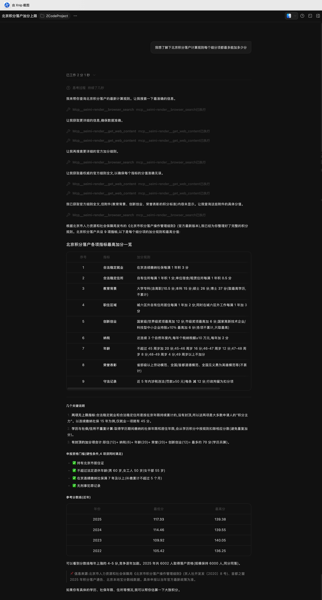

# 比 browser-use 更好用，SeimiRender 让你的 AI 在独立的无屏浏览器里工作，静默无干扰

你大概有过这样的体验：

让 AI Agent 帮你抓个网页、查个资料，它二话不说"啪"地抢过你的浏览器——弹窗、切标签、抢鼠标焦点，你正码着代码它突然把你的当前页导航走了。等它忙活完，你的工作流也被搅得一团糟。

更尴尬的是，很多浏览器自动化工具本身**就跑在你日常使用的那个浏览器里**，你的登录态、你的 cookie、你的标签页，全和 Agent 的工作搅在一起。Agent 一旦操作失误，遭殃的是你自己。

**SeimiRender 想解决的就是这件事。**

它给 AI 准备了一个**完全独立的、无头的、无屏的 Chromium 浏览器**。你的 AI 在这个隔离的沙盒里尽情渲染、点击、搜索、抓取——而你在自己屏幕上该干嘛干嘛，**互不打扰**。

一句话定位：**它是 AI Agent 专属的浏览器基础设施。**

---

## 它到底是什么

SeimiRender 是一个基于 Chromium（QtWebEngine）的网页渲染服务。它的更原始前身是开源项目 SeimiAgent，SeimiRender 是其现代化升级版。

你只需要提交一个 URL，它就会用**真实浏览器行为**去渲染页面——执行 JS、等待异步内容加载、跑完 SPA 路由——然后把渲染后的完整结果交还给你：HTML、Markdown 正文、PDF、截图，甚至是结构化的搜索引擎结果 JSON。

它默认以 **offscreen 无头模式**运行，不需要显示器。这意味着：

- ✅ 它不会抢占你的鼠标和键盘焦点
- ✅ 它不会在任务栏闪烁打扰你
- ✅ 你本地浏览器的操作不会干扰它的渲染结果
- ✅ 它的渲染也不会干扰你正在看的页面

**AI 有 AI 的浏览器，你有你的浏览器，井水不犯河水。**

更关键的是，它**原生支持 MCP 协议**。这意味着 ZCode、Claude Code、Cursor、Codex 这些主流 AI Agent 客户端，开箱即用就能把它当成一个"网页渲染工具"来调用——Agent 自己决定什么时候该开网页、读什么内容，全程不需要你手写 URL 或解析 HTML。

接入只需几行配置：

```json
{
  "mcpServers": {
    "seimi-render": {
      "type": "http",
      "url": "http://127.0.0.1:8090/mcp"
    }
  }
}
```

配好之后，你直接对 Agent 说一句"帮我查一下北京种植牙哪些医院靠谱"，Agent 就会自动规划：调搜索引擎拿结构化结果 → 挑几条点进去渲染全文 → 综合给你一个像样的回答。整个过程，**屏幕上静悄悄的**。

---

## 四个值得重点关注的应用场景

基于这套"独立无屏浏览器 + MCP 原生接入"的能力，SeimiRender 至少能在下面四个场景里成为你得力的基础设施。

### 场景一：Agent 自我迭代反馈的完美沙盒——可以作为 AI 基础设施服务

这是 SeimiRender 最具想象力的一个用法，也是它区别于普通"网页抓取工具"的本质所在。

现在的 AI Agent（尤其是 Vibe Coding 场景下的编码 Agent）越来越需要一种能力：**跑起来，看看效果，根据反馈再优化**。这个"跑起来"往往就涉及打开浏览器、渲染页面、验证交互。

如果这个验证环节跑在你自己的日常浏览器里，那简直是灾难——Agent 一次次刷新、导航、抢占焦点，你根本没法并行工作。而且验证环境和你真实工作环境混在一起，脏数据、脏状态互相污染。

SeimiRender 提供的则是一个**干净的、隔离的、可重复的沙盒**：

- Agent 把渲染任务丢给 SeimiRender，在独立的无头浏览器里跑
- 拿回渲染结果（HTML / 截图 / 结构化数据）作为反馈输入
- 基于反馈继续迭代优化代码或策略
- 全程不碰你的工作环境

它甚至支持**登录态持久化**（cookie 加密落盘，重启自动恢复），配合自带的 Chrome 插件可以一键把你的登录态同步进来，让沙盒里的浏览器也"登录着"，验证需要登录的页面也不在话下。

**换句话说，SeimiRender 可以成为 Agent 进行强化学习（RL）式自动迭代的"眼睛"和"手脚"**——一个稳定、可复现、不打扰人的反馈通道。把它作为 AI 基础设施服务常驻跑着，你的 Agent 就有了随时可用的、属于自己的浏览器环境。

### 场景二：复杂动态网页的自动化信息获取

很多有价值的信息，藏在 JS 动态渲染的页面背后。

传统的爬虫面对 SPA（单页应用）、Ajax 异步加载、需要等 JS 执行的页面，基本束手无策——拿到的往往是一堆空壳 HTML。SeimiRender 用真实 Chromium 渲染，这些都不是问题：

- 执行完整 JS，包括 Ajax 异步请求
- 支持 SPA 路由切换后的内容
- 可配置 `settle_ms`，在页面加载完成后额外等待 JS 执行
- 内置 Mozilla Readability 正文提取，自动去掉导航、广告、侧栏，返回干净的 Markdown 正文

配合 MCP 接入，Agent 可以自然语言驱动整个流程。用户给一句话需求，Agent 自动"渲染目标页 → 提取正文 → 结构化分析"，**无需用户手写 URL 或写解析代码**。

需要渲染**登录后才看得见**的页面（个人后台、付费内容、内部系统）？配套的 Chrome 插件一键把浏览器里的登录 cookie 同步过来，SeimiRender 渲染这些域名时就会自动带上登录态。cookie 加密落盘，重启自动恢复，同步一次长期可用。

实测数据可以参考：搜狐首页这类内容密集的页面，渲染耗时约 8.5 秒，返回约 220KB 的完整 HTML，包含 44 个 script、406 个链接——这就是 Chromium 执行完所有 JS 后的完整 DOM。传统爬虫根本拿不到这个结果。

### 场景三：不限额的免费搜索引擎 API 化

这可能是 SeimiRender 最"实用主义"的一个能力。

各大搜索引擎的官方 API，要么收费、要么额度感人、要么申请繁琐。但搜索引擎本身是免费开放的——问题只是，它返回的是给人看的 HTML，不是给程序用的 JSON。

SeimiRender 把这件事彻底 API 化了。它内置了对**百度、必应、Google** 搜索结果的结构化提取能力：渲染搜索结果页，注入提取脚本，**自动去掉广告**，返回干净的结构化 JSON——每条结果包含标题、URL、摘要、来源，还附带"相关搜索"。

通过 MCP 工具 `browser_search`，Agent 只需传一个关键词和引擎名，就能拿到结构化搜索结果：

> 用户说"搜一下 / 查一下 / Google it / 帮我了解…"但没给具体 URL → Agent 自动调 `browser_search`

**相当于你有了一个不限次数、不花钱、支持多引擎的搜索 API。** 对于做舆情监控、竞品追踪、信息聚合的应用来说，这等于打通了一条免费且稳定的数据来源通道。

而且 SeimiRender 在反爬上做了不少工程化处理：

- **stealth 模式**默认开启，伪装成统一的 Chrome 桌面环境（UA / screen / WebGL / canvas 指纹），融入人群绕过基础反爬
- **Google 会话预热**：进程启动时先隐藏加载一次 google.com 拿到会话 cookie 再接业务请求，规避冷启动风控高危窗口
- 命中验证页（如 Google `/sorry/`）会自动退避重试，重试耗尽则明确返回 `blocked` 标记，方便调用方换引擎或走代理
- 支持**运行时代理热切换**（`--proxy` / `POST /proxy`），可接入代理池彻底避开 IP 流控，全程无需重启

### 场景四：配合 HAR 录制能力，高效自动化信息挖掘

这是 SeimiRender 一个非常硬核、却容易被忽略的能力。

开启 `--remote-debugging-port` 后，渲染时带上 `record_network=true`，SeimiRender 就会**录制页面加载的全过程网络流量**——所有 HTTP 请求与响应，包括 headers、状态码、响应体、timing——产出**标准 HAR 1.2 文件**。

这跟你在 Chrome DevTools 里点"Save all as HAR"是一模一样的东西。录制的 HAR 可以直接导入 Chrome DevTools、Charles、haralyzer 等工具分析。

**这能用来干嘛？信息挖掘的想象空间极大：**

- **接口逆向**：很多网站的数据接口藏在 JS 调用里，渲染一次录下 HAR，所有 XHR/fetch 请求一览无余，直接定位到真正的数据 API
- **性能分析**：分析页面加载瓶颈，做前端性能优化
- **自动化数据采集链路搭建**：先录一次摸清接口结构，再写脚本批量调用，效率远超解析渲染后的 HTML

它通过 CDP（Chrome DevTools Protocol）订阅 Network 事件，按 requestId 聚合，进程内嵌实现，不依赖任何外部 CDP 客户端。响应体默认全量捕获，单条超过 1MB 时智能降级（只留 size 不留 text，省内存）。

Agent 侧的闭环也很顺：`render_url` 带 `record_network=true` 渲染 → 用 `get_har` 按 task_id 取 HAR JSON → 直接分析或落盘。**整个"渲染 + 录制 + 取结果"的链路，Agent 一气呵成。**

---

## 效果演示：一次多步协同的完整链路

理论说多了不如看实战。下面这张图展示的是 Agent 在单次会话内处理复杂需求的真实过程。



复杂需求下，Agent 会自动把任务**拆解为多步**：

1. 先渲染目标页
2. 读取结构化结果
3. 再渲染关联页，或调用搜索引擎结果提取（百度 / 必应 / Google SERP）
4. 综合输出最终答案

图中展示的，正是 Agent 在**单次会话内连续调用多次 MCP 工具 + 中间思考**的完整链路。你会看到它如何像一个真正的人类研究员那样：先搜索、再筛选、再深入阅读、最后归纳——只不过这一切都发生在 SeimiRender 那个静默的独立浏览器里，**屏幕上没有任何打扰**。

这就是 SeimiRender 配合 AI Agent 工作时该有的样子。

---

## 上手成本极低

如果你已经被打动了，好消息是 SeimiRender 的上手成本几乎为零。

**不想编译？** 直接去 GitHub Releases 下载对应平台的现成包，开箱即用：

👉 https://github.com/zhegexiaohuozi/seimi-render/releases

**启动服务**（macOS 示例）：

```bash
build/seimi-render.app/Contents/MacOS/seimi-render --http-port 8088 --ws-port 8089
```

**接入 Agent**：把前面那段 MCP 配置贴进你的 Agent 客户端（Claude Code 的 `~/.claude.json`、Cursor 的 MCP 设置、ZCode 配置等）即可。

它还自带一个**图形化管理后台**（浏览器访问根路径即打开），把运行状态监控、渲染测试台、cookie 管理、Agent 接入配置、完整接口文档全收进一个 Web 界面——本地或远程都能用，不用 SSH 进服务器敲命令。配置 JSON 还能在后台"配置示例"标签页一键复制。

---

## 写在最后

AI Agent 的能力边界，很大程度上取决于它"能看到什么、能做到什么"。

browser-use 这类工具让 AI 第一次能操作浏览器，意义非凡。但当 Agent 真正要常驻工作、要并行多任务、要进行自我迭代验证时，**和你抢同一个浏览器**这件事就成了最大的瓶颈。

SeimiRender 给出的答案是：**别抢了，给 AI 一个属于它自己的浏览器。**

独立、无屏、静默、隔离，原生 MCP，登录态可继承，搜索可结构化，流量可录制。它不是一个"网页抓取工具"，而是 **AI 时代的浏览器基础设施**。

如果你的工作流里，AI 经常需要看网页、查资料、抓数据、做验证——SeimiRender 值得一试。

项目已开源（Apache License 2.0），欢迎 Star：

🔗 https://github.com/zhegexiaohuozi/seimi-render

---

*SeimiRender —— 让你的 AI，在属于它自己的浏览器里，安静地把活干漂亮。*
